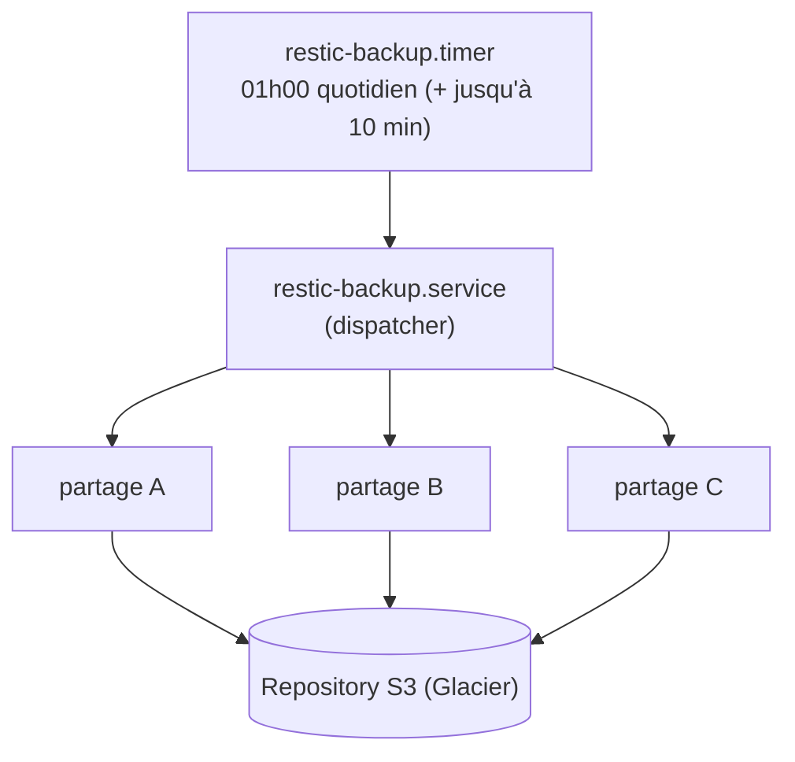

# Vue d'ensemble et utilisation (résumé opérateur)

Ce document est un résumé lisible de la solution, pensé pour un
opérateur qui prend en main le système - le README (racine du repo)
reste la référence technique complète (chaque script, chaque variable
de config, chaque incident déjà rencontré et sa correction).

## Vue d'ensemble

Sauvegarde quotidienne automatisée de partages NFS/CIFS montés
localement vers un repository S3 (storage class Glacier), avec
rétention, vérification de restaurabilité et alerting - pour remplacer
des backups ad-hoc par un système supervisé et garanti cohérent, même
sur des volumes de plusieurs dizaines de téraoctets.

## Architecture

Le timer ne fait que démarrer le dispatcher chaque jour ; le
dispatcher lit `shares.conf` et démarre une instance systemd
indépendante par share (`restic-backup@<share>.service`), chacune avec
son propre `restic backup` et sa propre politique de rétention. Ce
découpage en deux couches existe pour une raison précise : si un seul
service bouclait sur tous les shares, un share lent encore en cours le
lendemain bloquerait silencieusement le backup de tous les autres -
systemd refuse de démarrer une deuxième instance d'une unité encore
active. En rendant le dispatcher trivial (il ne fait que lancer,
jamais attendre), lui seul n'est jamais encore actif le lendemain ; un
share lent ne bloque plus que son propre run suivant.

## Consistance des données via snapshot NetApp (optionnel, par share)

Pour les shares hébergés sur le cluster NetApp ONTAP, un backup direct
du filesystem live pose un problème sur un gros volume : le parcours
peut prendre des heures, pendant lesquelles les données continuent de
changer, si bien que restic sauvegarde un mélange de plusieurs
instants plutôt qu'un état cohérent.

Le script évite ça en figeant les données avant de backuper, via l'API
REST ONTAP :

1. Crée un snapshot NetApp instantané du volume (quasi immédiat côté
   stockage).
2. Bind-mount ce snapshot figé sur le point de montage du share, à la
   place du live - restic voit toujours le même chemin, mais son
   contenu est maintenant figé.
3. Lance `restic backup` sur ce point de montage.
4. Démonte le bind-mount et supprime le snapshot NetApp, quoi qu'il
   arrive (même en cas d'erreur ou d'interruption).

C'est entièrement opt-in, configuré par share dans
`netapp-volumes.conf` : un share non listé continue de backup en
direct, sans aucun changement de comportement.

## Maintenance, rétention et vérification

`restic-maintenance.timer` lance chaque jour à 23h00 (deux heures
avant le backup du lendemain, pour garder de la marge) l'application
de la politique de rétention (`forget --prune`, qui élimine les
anciens snapshots selon la politique `short`/`long` de chaque share)
et un contrôle d'intégrité du repository (`check`).

Vérifier qu'un backup existe ne prouve pas qu'il est restaurable.
`resticctl verify` restaure réellement un échantillon de données
depuis le repository pour le confirmer - à exécuter périodiquement,
pas seulement en cas de doute.

## Alerting

Chaque tâche automatisée (backup, maintenance, verify) écrit son
résultat dans un fichier de statut simple
(`/var/log/restic/status/*.status`), consultable par n'importe quel
outil de monitoring sans configuration. `restic-backup.sh` écrit aussi
un fichier par share, qui est ce que lit `resticctl status`.

Un email est envoyé automatiquement en cas d'échec
(`RESTIC_NOTIFY_ON="failure"`), et un rapport quotidien récapitulatif
est envoyé par `restic-report.timer`.

## Utilisation au quotidien

Tout passe par `resticctl` :

| Commande | Effet |
| --- | --- |
| `resticctl status` | État de chaque share (en cours/idle, dernier résultat) et prochain run planifié |
| `resticctl backup --manual <share>` | Force un backup immédiat d'un share précis |
| `resticctl backup-all` | Lance tous les shares maintenant, en parallèle |
| `resticctl list [--path <share>]` | Liste les snapshots existants |
| `resticctl verify --target <path> <share>` | Teste une vraie restauration |
| `resticctl add-share --type nfs/cifs --source <src> --mount <path> --policy <name>` | Ajoute un nouveau share |
| `resticctl report` | Force l'envoi du rapport email |
| `resticctl version` | Quel commit est déployé |

Ajouter un share ne nécessite pas d'activer un timer séparé : le
dispatcher relit `shares.conf` à chaque run et démarre automatiquement
une instance pour tout nouveau share.
